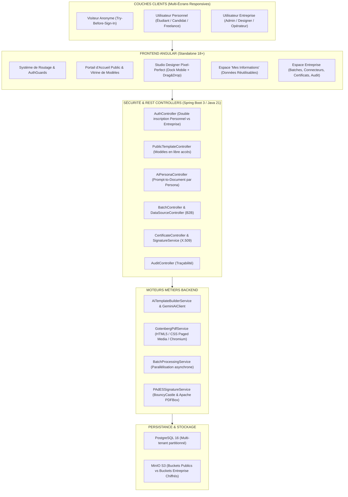

# Plan Technique d'Implémentation Complet : Architecture Duale (Service Tout Public & Service Entreprise)

> **Document Technique d'Ingénierie & d'Exécution**  
> *Projet : Moteur de Génération & Studio de Rapports*  
> *Version : 1.0.0 — Octobre 2026*  
> *Statut : Spécification Technique Prête pour Implémentation*

---

## 1. Architecture Globale du Système

### 1.1 Schéma d'Architecture Cible

L'architecture repose sur un socle unique découplé en deux modes d'exploitation :
* **Mode Public / Personnel (B2C)** : Convivial, axé sur les personas (étudiants, candidats, freelances, créateurs), modèles phares prêts à l'emploi, assistant IA guidé, profil universel de données.
* **Mode Entreprise (B2B)** : Gouvernance documentaire, multi-tenancy d'équipe, connecteurs SQL/REST, traitements par lots massifs (Excel/CSV), signatures électroniques certifiées X.509 PAdES et audit trails immuables.



---

### 1.2 Matrice des Profils & Permissions

| Fonctionnalité | Visiteur Anonyme | Utilisateur Personnel (B2C) | Utilisateur Entreprise (B2B) |
| :--- | :---: | :---: | :---: |
| **Accès au portail et à la vitrine de modèles** | ✅ Oui | ✅ Oui | ✅ Oui |
| **Création et édition dans le Studio** | ✅ Oui (Session locale) | ✅ Oui (Persistance cloud) | ✅ Oui (Persistance cloud) |
| **Pack de modèles Grand Public (CVs, Stage, Facture)** | ✅ En aperçu | ✅ Illimité & Sauvegardable | ✅ Illimité & Personnalisable |
| **Profil Universel "Mes Données" (Auto-sync)** | ❌ Non | ✅ Oui | ✅ Optionnel (Profil collaborateur) |
| **Génération IA par Prompt Persona** | ✅ 3 essais démo | ✅ Illimité gratuit | ✅ Illimité avec contexte corporate |
| **Export PDF Haute Définition (sans filigrane)** | ❌ Filigrane démo | ✅ Gratuit sans filigrane | ✅ Gratuit sans filigrane |
| **Génération par lots (Batches CSV/Excel/JSON)** | ❌ Non | ❌ Masqué | ✅ Jusqu'à 50 000 lignes |
| **Connecteurs de données SQL (PostgreSQL, MySQL, API)** | ❌ Non | ❌ Masqué | ✅ Temps réel |
| **Planifications automatiques (Cron jobs)** | ❌ Non | ❌ Masqué | ✅ Illimité |
| **Signature électronique X.509 PAdES** | ❌ Non | ❌ Masqué | ✅ Certificats PKCS#12 |
| **Piste d'Audit & Gouvernance SOC2/RGPD** | ❌ Non | ❌ Masqué | ✅ Journalisation immuable |

---

### 1.3 Évolution du Schéma de Base de Données PostgreSQL

```mermaid
erDiagram
    APP_USER ||--o{ WORKSPACE : owns
    APP_USER ||--o| PERSONA_PROFILE : has
    ENTREPRISE ||--o{ APP_USER : members
    ENTREPRISE ||--o{ COMPANY_WORKSPACE_CONFIG : configures
    ENTREPRISE ||--o{ REPORT_TEMPLATE : owns_corporate
    REPORT_TEMPLATE ||--o{ REPORT_VARIABLE : contains
    REPORT_TEMPLATE ||--o{ DOCUMENT : generates
    REPORT_TEMPLATE }o--|| TEMPLATE_CATEGORY : belongs_to

    APP_USER {
        uuid id PK
        string email UK
        string mot_de_passe
        string nom
        string prenom
        string account_type "PERSONAL | ENTERPRISE"
        string target_persona "STUDENT | CANDIDATE | FREELANCE | INDIVIDUAL"
        uuid entreprise_id FK "Nullable pour Personal"
        string role "ADMIN | DESIGNER | OPERATEUR | GUEST"
        boolean actif
        timestamp date_creation
    }

    PERSONA_PROFILE {
        uuid id PK
        uuid user_id FK UK
        jsonb personal_info "nom, prenom, email, telephone, adresse, linkedin, github, site"
        jsonb experiences "postes, entreprises, dates, realisations_chiffrees"
        jsonb formations "diplomes, ecoles, annees, mentions"
        jsonb competences "techniques, linguistiques, soft_skills, certifications"
        jsonb preferences "default_country, currency, photo_url"
        timestamp updated_at
    }

    REPORT_TEMPLATE {
        uuid id PK
        string nom
        string description
        string visibilite "PUBLIC | ENTREPRISE | PRIVE"
        string category_code "CV_CANADIAN | CV_ATS | STAGE_REPORT | FREELANCE_INVOICE | FLYER"
        jsonb structure_blocks "Liste ordonnee des blocs SVG/HTML/CSS"
        string format_papier "A4 | LETTER | A5"
        string orientation "PORTRAIT | LANDSCAPE"
        boolean is_official_pack "true pour les modeles natifs"
        uuid createur_id FK
        uuid entreprise_id FK "Nullable pour templates publics"
        timestamp date_creation
    }
```

---

## 2. Phase 1 : Portail Public Convivial, Pack de Modèles Phares & Double Connexion

### 2.1 Objectifs de la Phase 1
1. Créer une page d'accueil / vitrine publique magnifique, conviviale et engageante, accessible sans authentification préalable.
2. Déployer la double porte d'entrée à l'inscription et la connexion (**Compte Personnel** vs **Compte Entreprise**).
3. Intégrer les 5 modèles de documents phares dans la base de données avec des templates professionnels conformes aux normes internationales.
4. Permettre l'expérience **Try-Before-Sign-In** : n'importe qui peut ouvrir un modèle dans le Studio et le manipuler sans compte.

---

### 2.2 Tâches Backend (Spring Boot)

#### Tâche BE-1.1 : Évolution du modèle `User` et DTOs d'authentification
* **Fichiers modifiés / créés** :
  * `backend/src/main/java/com/rapports/moteur/entity/AccountType.java` (Enum : `PERSONAL`, `ENTERPRISE`)
  * `backend/src/main/java/com/rapports/moteur/entity/TargetPersona.java` (Enum : `STUDENT`, `CANDIDATE`, `FREELANCE`, `INDIVIDUAL`)
  * `backend/src/main/java/com/rapports/moteur/entity/User.java` :
    * Ajout de `accountType` (défaut `PERSONAL`).
    * Ajout de `targetPersona` (optionnel).
    * `entreprise` devient `@ManyToOne(optional = true)`.
  * `backend/src/main/java/com/rapports/moteur/dto/auth/RegisterRequest.java` :
    * Support du champ `accountType`.
    * Si `accountType == PERSONAL` : `nomEntreprise` et `codeEntreprise` deviennent facultatifs.
  * `backend/src/main/java/com/rapports/moteur/service/AuthService.java` :
    * Gestion de l'inscription personnelle : création automatique d'un workspace personnel privé sans exiger de nom d'entreprise.

#### Tâche BE-1.2 : Endpoints Publics de Modèles
* **Fichiers modifiés / créés** :
  * `backend/src/main/java/com/rapports/moteur/controller/PublicPortalController.java` :
    * `GET /api/public/templates` : Récupération des modèles publics avec filtres par persona et catégorie (`CV_CANADIAN`, `CV_ATS`, `STAGE_REPORT`, `FREELANCE_INVOICE`, `FLYER`).
    * `GET /api/public/templates/{id}` : Détails d'un modèle public pour affichage et édition immédiate.
    * `POST /api/public/templates/{id}/demo-render` : Génération Gotenberg directe d'un aperçu PDF avec filigrane discret pour les visiteurs non connectés.
  * `backend/src/main/java/com/rapports/moteur/security/SecurityConfig.java` :
    * Déclaration de `/api/public/**` en `permitAll()`.

#### Tâche BE-1.3 : Initialisation des Modèles Phares (Data Seeding)
* **Fichier créé** : `backend/src/main/java/com/rapports/moteur/init/PublicTemplatePackSeeder.java` :
  * Injecte au démarrage les 5 modèles officiels haute qualité si non présents :
    1. **`CV_CANADIAN_PRO`** (Format Letter, 2 pages, zéro photo, zéro âge/sexe, sections compétences clés, verbes d'action, réalisations chiffrées).
    2. **`CV_US_ATS_CLEAN`** (Format Letter, 1 page stricte, typographie universelle, 100% compatible parseurs automatiques ATS).
    3. **`CV_EURO_MODERNE`** (Format A4, photo de profil détourée, sidebar de compétences dynamiques, chronologie soignée).
    4. **`RAPPORT_STAGE_UNIVERSITAIRE`** (Format A4, page de garde officielle logos université + entreprise, sommaire hiérarchique, pagination Page X sur Y).
    5. **`FACTURE_FREELANCE_LEGALE`** (Format A4, calculs automatiques des totaux, ventilation TVA, bloc bancaire IBAN, mentions légales).

---

### 2.3 Tâches Frontend (Angular)

#### Tâche FE-1.1 : Portail d'Accueil Public Convivial (`PublicPortalComponent`)
* **Fichiers créés** :
  * `frontend/src/app/public/public-portal.component.ts`
  * `frontend/src/app/public/public-portal.component.html`
  * `frontend/src/app/public/public-portal.component.scss`
* **Spécifications UX/UI** :
  * Hero section chaleureuse et moderne : *"Créez des documents d'exception en 2 minutes. 100% Gratuit pour tous."*
  * Sélecteur interactif par persona :
    * 🎓 **Étudiants** (Rapports de stage, PFE, thèses)
    * 💼 **Candidats & Carrière** (CV Canadien, CV ATS Américain, CV Européen)
    * 📊 **Comptables & Freelances** (Factures, devis, attestations)
    * 🎨 **Événements & Particuliers** (Flyers, certificats, menus)
  * Grille de modèles avec prévisualisation haute fidélité au survol et bouton direct : **"Personnaliser ce modèle"**.
  * Bouton d'accès rapide **"Espace Entreprise"** en en-tête pour les organisations.

#### Tâche FE-1.2 : Refonte de la Page d'Inscription (`RegisterComponent`)
* **Fichiers modifiés** :
  * `frontend/src/app/auth/register/register.component.html`
  * `frontend/src/app/auth/register/register.component.ts`
  * `frontend/src/app/auth/register/register.component.scss`
* **Spécifications UI** :
  * Sélecteur à deux onglets visuels en haut du formulaire :
    * **👤 Compte Personnel (Gratuit)** : champs simplifiés (Nom, Prénom, Email, Mot de passe).
    * **🏢 Compte Entreprise** : champs professionnels (Nom, Prénom, Email pro, Nom de l'entreprise, Code d'accès organisation).
  * Design épuré, responsive mobile et validation instantanée.

#### Tâche FE-1.3 : Mise à jour du Routage & Navigation Globale
* **Fichier modifié** : `frontend/src/app/app.routes.ts` :
  * Route racine `path: ''` orientée vers `PublicPortalComponent` si non authentifié.
  * Si authentifié en tant que `PERSONAL` $\to$ redirection vers le hub personnel `/bibliotheque`.
  * Si authentifié en tant que `ENTERPRISE` $\to$ accès aux routes complètes `/batches`, `/data-sources`, `/certificates`, `/audit`.
* **Fichier modifié** : `frontend/src/app/app.ts` :
  * La barre de navigation adapte ses onglets selon le rôle de l'utilisateur :
    * Utilisateur Personnel : *Modèles*, *Mes Documents*, *Mon Profil*.
    * Utilisateur Entreprise : *Modèles*, *Documents*, *Lots*, *Connecteurs*, *Planifications*, *Certificats*, *Audit*.
    * Bouton bascule *"Passer en mode Entreprise"* mis en avant.

---

## 3. Phase 2 : Assistant IA Multi-Persona, Profil Universel & Partage Viral

### 3.1 Objectifs de la Phase 2
1. Développer l'assistant IA spécialisé par persona : capable de générer instantanément un document complet adapté à la demande en langage naturel.
2. Mettre en place l'espace **"Mes Informations"** (Profil Universel) : l'utilisateur saisit son CV ou ses coordonnées une seule fois, et tous les modèles se pré-remplissent automatiquement.
3. Développer les fonctionnalités de partage viral : export en image PNG haute qualité pour réseaux sociaux (LinkedIn) et page web de consultation publique sécurisée avec QR Code.

---

### 3.2 Tâches Backend (Spring Boot)

#### Tâche BE-2.1 : Service de Génération IA par Persona (`AiPersonaTemplateService`)
* **Fichier créé** : `backend/src/main/java/com/rapports/moteur/service/ai/AiPersonaTemplateService.java` :
  * Prompts système spécialisés avec contraintes strictes :
    * **Prompt CV Canadien** : Bannit explicitement photo, date de naissance, âge et statut marital. Exige des puces axées sur les accomplissements chiffrés.
    * **Prompt CV ATS** : Exige une structure linéaire standardisée sans éléments graphiques perturbateurs pour les lecteurs automatisés.
    * **Prompt Rapport de Stage** : Construit une table des matières équilibrée (Présentation de l'entreprise, Missions, Analyse critique, Remerciements, Conclusion).
    * **Prompt Facture** : Calcule les montants et structure les tableaux financiers.
  * Endpoint : `POST /api/ai/persona-generate` acceptant `{ personaType, userPrompt, targetLanguage }`.

#### Tâche BE-2.2 : Entité et API du Profil Universel (`PersonaProfile`)
* **Fichiers créés** :
  * `backend/src/main/java/com/rapports/moteur/entity/PersonaProfile.java` : entité liée au `User` stockant les données structurées en JSONB (`personal_info`, `experiences`, `formations`, `competences`).
  * `backend/src/main/java/com/rapports/moteur/repository/PersonaProfileRepository.java`
  * `backend/src/main/java/com/rapports/moteur/controller/PersonaProfileController.java` :
    * `GET /api/user/profile` : Récupération du profil.
    * `PUT /api/user/profile` : Mise à jour et synchronisation.

#### Tâche BE-2.3 : Service de Consultation Web Publique & QR Code
* **Fichiers créés / modifiés** :
  * `backend/src/main/java/com/rapports/moteur/controller/PublicViewerController.java` :
    * `GET /api/public/documents/view/{shareToken}` : Retourne les métadonnées et le contenu du document pour affichage web sécurisé sans connexion requise.

---

### 3.3 Tâches Frontend (Angular)

#### Tâche FE-2.1 : Wizard IA Guidé par Persona
* **Fichiers créés** :
  * `frontend/src/app/designer/components/ai-persona-wizard/ai-persona-wizard.component.ts`
  * `frontend/src/app/designer/components/ai-persona-wizard/ai-persona-wizard.component.html`
  * `frontend/src/app/designer/components/ai-persona-wizard/ai-persona-wizard.component.scss`
* **Spécifications UI** :
  * Dialogue immersif en 3 étapes :
    1. *Quel document souhaitez-vous créer ?* (CV, Rapport, Lettre, Facture, Flyer).
    2. *Parlez-nous de vous ou de votre besoin* (zone de texte avec suggestions d'exemples pré-rédigés).
    3. *Génération magique* : barre de progression animée et aperçu instantané du document généré.

#### Tâche FE-2.2 : Page de Gestion "Mon Profil / Mes Données"
* **Fichiers créés** :
  * `frontend/src/app/profile/personal-profile.component.ts`
  * `frontend/src/app/profile/personal-profile.component.html`
  * `frontend/src/app/profile/personal-profile.component.scss`
* **Spécifications UI** :
  * Onglets clairs : *Identité*, *Expériences*, *Formations*, *Compétences*.
  * Bouton magique dans le Studio Designer : **"Remplir avec mes données de profil"** permettant d'injecter en 1 clic toutes ses informations dans n'importe quel modèle.

#### Tâche FE-2.3 : Export PNG & Page de Partage Public
* **Fichiers modifiés / créés** :
  * `frontend/src/app/designer/report-designer/report-designer.ts` : ajout de l'option d'export `exportAsImage('PNG')` via html2canvas ou Gotenberg render image.
  * `frontend/src/app/public/document-viewer/document-viewer.component.ts` : visionneuse web responsive permettant à un recruteur de consulter un CV ou rapport en ligne avec bouton de téléchargement PDF.

---

## 4. Phase 3 : Passerelle B2B Entreprise, Auth Sociale & Préparation de la Croissance

### 4.1 Objectifs de la Phase 3
1. Permettre aux utilisateurs personnels de basculer en 1 clic vers la création ou l'adhésion à un **Espace Entreprise**.
2. Intégrer l'authentification sociale (Google, GitHub, Microsoft) pour éliminer toute friction à l'inscription.
3. Afficher en direct sur le portail public les compteurs de popularité (*Preuve par le volume*).
4. Préparer l'infrastructure technique à l'introduction ultérieure de la monétisation (gestion des quotas, architecture de facturation prête).

---

### 4.2 Tâches Backend & Infrastructure

#### Tâche BE-3.1 : Passerelle d'Upgrade vers Entreprise
* **Fichier modifié** : `backend/src/main/java/com/rapports/moteur/service/EntrepriseService.java` :
  * Méthode `upgradeToEnterprise(UUID userId, EnterpriseCreationDto dto)` :
    * Crée l'entité `Entreprise`.
    * Associe l'utilisateur en tant que `Role.ADMIN`.
    * Migre ou conserve ses documents personnels dans un sous-espace privé de l'organisation.

#### Tâche BE-3.2 : Authentification Sociale OAuth2
* **Fichiers modifiés** :
  * `backend/pom.xml` : ajout de `spring-boot-starter-oauth2-client`.
  * `backend/src/main/java/com/rapports/moteur/security/oauth2/OAuth2AuthenticationSuccessHandler.java` :
    * Récupère l'email et le profil depuis Google ou GitHub.
    * Crée ou connecte l'utilisateur en mode `AccountType.PERSONAL` et génère le token JWT.

#### Tâche BE-3.3 : Métriques Publiques en Temps Réel
* **Fichier créé** : `backend/src/main/java/com/rapports/moteur/controller/PublicStatsController.java` :
  * `GET /api/public/stats` : retourne le nombre total de documents générés, le nombre d'utilisateurs actifs et les modèles les plus populaires (données mises en cache avec Redis ou cache en mémoire Caffeine).

---

### 4.3 Tâches Frontend (Angular)

#### Tâche FE-3.1 : Modale "Créer une Organisation Entreprise"
* Intégration d'un bouton dans le menu utilisateur permettant à un freelance ou salarié de configurer son entreprise en quelques clics.

#### Tâche FE-3.2 : Intégration des Boutons OAuth2 sur la Page de Connexion
* Ajout des boutons *"Continuer avec Google"* et *"Continuer avec GitHub"* sur `LoginComponent` et `RegisterComponent`.

#### Tâche FE-3.3 : Compteurs Dynamiques sur le Portail Public
* Bandeau de statistiques animé sur `PublicPortalComponent` : *"Déjà +250 000 documents générés"*.

---

## 5. Matrice Exhaustive des Fichiers & Dépendances

```
+------------------------------------------------------------------------------------------------+
| PHASE 1 : PORTAIL GRAND PUBLIC, PACK DE MODÈLES & DOUBLE CONNEXION                             |
+------------------------------------------------------------------------------------------------+
| Backend :                                                                                      |
|  * entity/AccountType.java                                    [Nouveau]                        |
|  * entity/TargetPersona.java                                  [Nouveau]                        |
|  * entity/User.java                                           [Modifié - accountType, null org]|
|  * dto/auth/RegisterRequest.java                              [Modifié - support personnel]    |
|  * service/AuthService.java                                   [Modifié - flux sans entreprise] |
|  * controller/PublicPortalController.java                     [Nouveau - templates libres]     |
|  * init/PublicTemplatePackSeeder.java                         [Nouveau - 5 modèles officiels]  |
|  * security/SecurityConfig.java                               [Modifié - permitAll /public]    |
|                                                                                                |
| Frontend :                                                                                     |
|  * public/public-portal.component.{ts,html,scss}              [Nouveau - Accueil convivial]    |
|  * auth/register/register.component.{ts,html,scss}            [Modifié - Onglets Personnel/Ent]|
|  * app.routes.ts                                              [Modifié - redirection & guards] |
|  * app.{ts,html,scss}                                         [Modifié - nav bars adaptatives] |
+------------------------------------------------------------------------------------------------+
| PHASE 2 : ASSISTANT IA PAR PERSONA, PROFIL UNIVERSEL & EXPORTS VIRAUX                          |
+------------------------------------------------------------------------------------------------+
| Backend :                                                                                      |
|  * service/ai/AiPersonaTemplateService.java                   [Nouveau - prompts spécialisés]  |
|  * entity/PersonaProfile.java                                 [Nouveau - CV & data jsonb]      |
|  * repository/PersonaProfileRepository.java                   [Nouveau]                        |
|  * controller/PersonaProfileController.java                   [Nouveau - CRUD profil B2C]      |
|  * controller/PublicViewerController.java                     [Nouveau - lien de consultation] |
|                                                                                                |
| Frontend :                                                                                     |
|  * designer/components/ai-persona-wizard/*                    [Nouveau - Wizard 3 étapes]      |
|  * profile/personal-profile.component.{ts,html,scss}          [Nouveau - Espace Mes Données]   |
|  * public/document-viewer/document-viewer.component.*          [Nouveau - Consultation web]     |
|  * designer/report-designer/report-designer.ts                [Modifié - export image & profil]|
+------------------------------------------------------------------------------------------------+
| PHASE 3 : PASSERELLE ENTREPRISE, AUTH SOCIALE & STATISTIQUES                                   |
+------------------------------------------------------------------------------------------------+
| Backend :                                                                                      |
|  * service/EntrepriseService.java                             [Modifié - upgradeToEnterprise]  |
|  * security/oauth2/*                                          [Nouveau - OAuth2 Google/GitHub] |
|  * controller/PublicStatsController.java                      [Nouveau - métriques publiques]  |
|                                                                                                |
| Frontend :                                                                                     |
|  * auth/login/login.component.{html,ts}                       [Modifié - boutons sociaux]      |
|  * public/public-portal.component.{html,ts}                   [Modifié - compteurs animés]     |
+------------------------------------------------------------------------------------------------+
```

---

## 6. Critères d'Acceptation & Plan de Tests

### 6.1 Tests Unitaires & Intégration Automatisés (JUnit 5 / Mockito)
1. **`AuthServiceTest`** :
   * Vérifier qu'une inscription avec `AccountType.PERSONAL` réussit sans renseigner de nom d'entreprise.
   * Vérifier qu'une inscription avec `AccountType.ENTERPRISE` exige et valide le nom d'entreprise.
2. **`PublicPortalControllerTest`** :
   * Vérifier que `GET /api/public/templates` renvoie bien les modèles officiels sans authentification (HTTP 200).
   * Vérifier que les filtres par persona (`STUDENT`, `CANDIDATE`, etc.) renvoient les modèles adéquats.
3. **`AiPersonaTemplateServiceTest`** :
   * Vérifier qu'une demande pour `CV_CANADIAN` ne contient aucun champ photo ni bloc d'état civil.
   * Vérifier qu'une demande pour `RAPPORT_STAGE` génère bien la table des matières et la numérotation hiérarchique.

### 6.2 Tests End-to-End & Validation Navigateur (Cypress / Playwright)
1. **Parcours Visiteur Anonyme** :
   * Accès à la page d'accueil `http://localhost/` $\to$ Choix du modèle "CV Canadien" $\to$ Ouverture dans le Studio $\to$ Modification de texte $\to$ Génération aperçu PDF avec filigrane $\to$ Succès.
2. **Parcours Inscription Personnelle** :
   * Clic sur "Créer un compte" $\to$ Sélection "Compte Personnel" $\to$ Inscription $\to$ Redirection vers le hub personnel $\to$ Téléchargement du PDF sans filigrane $\to$ Succès.
3. **Parcours Entreprise** :
   * Connexion en tant qu'entreprise $\to$ Accès vérifié aux menus `/batches` et `/data-sources` $\to$ Succès.
4. **Validation Responsive Multi-Écrans** :
   * Vérification sur résolutions mobiles ($375\times 667$, $414\times 896$) et tablettes ($768\times 1024$) : aucun débordement horizontal, dock mobile du designer actif et menu hamburger opérationnel.

