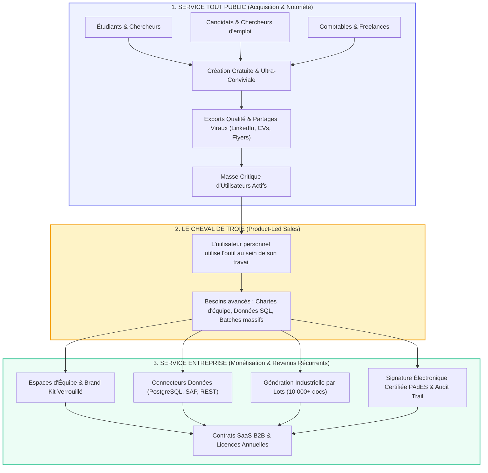
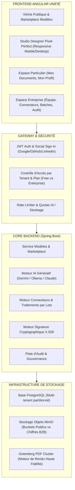

# Stratégie Produit & Architecture Duale : Du Service Tout Public (B2C / PLG) au Service Entreprise (B2B)

> **Document de Référence Stratégique, Fonctionnel et Technique**  
> *Auteur : Antigravity & Lead DevOps / Product Architect*  
> *Date : Octobre 2026*  
> *Statut : Proposition Stratégique Validée pour Implémentation*

---

## 1. Vision Globale : Le Modèle Dual Product-Led Growth (PLG)

### 1.1 La Vision Fondatrice
L'objectif est de transformer notre moteur de rapports en une **plateforme universelle de création et de génération de documents**, accessible à la fois au **Grand Public (étudiants, candidats, comptables, freelances, particuliers)** et aux **Grandes Entreprises / PME (reporting financier, automatisation ERP, conformité, signatures sécurisées)**.

L'écosystème repose sur un principe fondateur : **le modèle Product-Led Growth (PLG)**, similaire aux réussites fulgurantes de *Canva*, *Notion*, *Figma*, *Slack* ou *Overleaf*.



### 1.2 Pourquoi cette approche est imparable ?
1. **Lancement 100% Gratuit pour Tous** : Dès le départ, l'accès à l'ensemble des fonctionnalités publiques et de création est totalement gratuit (aucun paywall, aucun blocage frustrant). L'objectif absolu est de maximiser le nombre d'utilisateurs connectés, de créer un coup de cœur immédiat et une viralité maximale.
2. **Preuve par le volume & Publicité Organique pour l'Entreprise** : Plus il y a d'étudiants, de freelances et de particuliers qui utilisent et partagent leurs documents créés sur la plateforme, plus la notoriété grandit. Ce trafic massif sert de vitrine et de légitimité auprès des entreprises.
3. **Monétisation Différée** : Lorsque l'application sera reconnue et aura atteint sa masse critique, des options de monétisation ciblées (abonnements d'entreprise, SLA, etc.) pourront être introduites sereinement.

---

## 2. Benchmark Approfondi de l'Existant (Forces, Faiblesses & Opportunités)

Pour réussir, analysons précisément les plateformes existantes :

| Solution | Cible Principale | Forces Majeures | Faiblesses / Angles Morts | Notre Opportunité Distinctive |
| :--- | :--- | :--- | :--- | :--- |
| **Canva** | Tout public, marketing, créateurs | Interface ultra-séduisante, modèles infinis, glisser-déposer accessible. | Incapable de générer des rapports dynamiques basés sur des bases de données réelles (pas de boucles sur tableaux, pas d'injection de batches). Exports PDF souvent trop volumineux et non optimisés pour l'impression technique. | **Offrir la convivialité de Canva, mais avec un moteur de données réelles et des variables intelligentes.** |
| **Gamma.app** | Professionnels, consultants, étudiants | Génération IA "Prompt-to-Deck/Doc" ultra rapide, mise en page automatisée. | Manque de contrôle pixel-perfect strict (impossible de faire un CV 1 page exact, une facture normalisée ou un rapport avec pagination stricte A4). | **Associer l'IA générative à notre studio pixel-perfect avec règles de pagination physiques (A4/Letter).** |
| **Overleaf / LaTeX** | Étudiants en sciences, chercheurs, universités | Typographie irréprochable, gestion parfaite des thèses, formules mathématiques, pagination. | Barrière à l'entrée colossale : syntaxe de code complexe, zéro interface visuelle moderne, inadapté au grand public. | **Devenir le "Overleaf sans code" : des rapports académiques impeccables en glisser-déposer sans apprendre LaTeX.** |
| **Resume Builders (Reactive Resume, Resume.io, Zety)** | Candidats, diplômés | Modèles adaptés aux critères recruteurs (Canada, ATS américain, Europass). | Monotâche (uniquement du CV), modèles souvent payants avec des paywalls trompeurs qui déçoivent les utilisateurs. | **Intégrer les CVs internationaux au sein d'une suite documentaire complète et ouverte.** |
| **Moteurs B2B (Carbone.io, Docupilot, Jasper, PandaDoc)** | Développeurs, PME, grands comptes | Puissance des connecteurs JSON/SQL, signature numérique, robustesse d'API. | Interface austère, froide, aucune communauté publique, complexe pour un non-technicien. | **Nous possédons déjà ce moteur technique (Gotenberg, X.509, SQL) : il suffit de lui donner une vitrine grand public magnifique.** |

---

## 3. Spécifications du "Service Tout Public" (B2C)

Le Service Tout Public doit être une expérience **fluide, valorisante et addictive**. Un utilisateur doit pouvoir concevoir un document sublime en moins de **3 minutes**.

### 3.1 Catalogue de Documents par Persona

#### 🎓 Persona 1 : Étudiants, Stagiaires & Chercheurs
* **Rapports de Stage & PFE** :
  * Page de garde officielle avec logos entreprise + université, tuteur de stage, filière.
  * Sommaire automatique avec numérotation hiérarchique.
  * Fiche de remerciements, pagination stricte (Page X sur Y), index des figures.
* **Mémoires & Thèses Académiques** :
  * Modèle aux normes de citation (APA, Harvard), mise en page en 1 ou 2 colonnes, encarts méthodologiques.
* **Fiches de Révision & Synthèses** :
  * Dispositions condensées avec surlignages, boîtes d'astuces, listes mémo.

#### 💼 Persona 2 : Candidats & Évolution de Carrière
* **Le CV Canadien (Normes fédérales & provinciales strictes)** :
  * **Spécificités** : Strictement sans photo, sans mention d'âge, sans statut matrimonial ni nationalité (lois anti-discrimination).
  * Structure : Résumé des compétences (Core Competencies), réalisations quantifiées (*Action Verbs* + métriques), parcours chronologique inversé, maîtrise linguistique (Français / Anglais).
  * Longueur : 1 à 2 pages standard Letter (8.5 × 11 pouces).
* **Le CV Américain (US Resume - ATS-Friendly)** :
  * Format Letter 1 page stricte, typographie standard (Arial, Inter, Calibri), structure en colonne unique ou double colonne standardisée pour traverser les parseurs automatiques ATS sans rejet.
* **Le CV Français / Européen Moderne** :
  * Format A4, photo de profil détourée avec cercle élégant, barre latérale d'aptitudes techniques (skill badges), bilingue ou multilingue.
* **Lettres d'Accompagnement & Motivation** :
  * En-tête normalisé (expéditeur / destinataire / date / objet), mise en page typographique soignée, accroche personnalisée générée par IA.

#### 📊 Persona 3 : Comptables Indépendants, Artisans & Freelances
* **Factures & Devis Conformité Légale** :
  * Mentions obligatoires, calcul automatique des totaux HT, TVA ventilée, TTC, conditions de paiement, IBAN/BIC mis en avant.
* **Attestations & Lettres de Mission** :
  * Attestation d'honoraires, justificatif de domicile, quittance de loyer, certificat de travail.
* **Rapports Financiers & Tableaux de Bord Simplifiés** :
  * Synthèse des entrées/sorties avec graphiques intégrés, ratios de rentabilité.

#### 🎨 Persona 4 : Particuliers, Associations & Événements
* **Flyers Promotionnels & Affiches** :
  * Formats A5 et A6, fonds visuels attractifs, typographies d'impact, QR code pointant vers une billetterie ou un site.
* **Certificats & Diplômes Honorifiques** :
  * Bordures dorées/élégantes, police manuscrite pour le nom, cadre de signature officielle.
* **Menus de Restaurant & Catalogues Produits** :
  * Format 2 ou 3 volets avec grilles de prix claires.

---

### 3.2 Fonctionnalités Grand Public à Fort Effet "Waouh"

1. **Assistant IA "Prompt-to-Document" Réactif** :
   * L'utilisateur formule son besoin en langage naturel :  
     > *"Je suis un développeur Java avec 3 ans d'expérience cherchant un poste au Québec. Crée-moi un CV Canadien moderne 2 pages mettant en valeur mes compétences Spring Boot et Docker."*
   * L'IA analyse le persona, sélectionne la norme (CV Canada sans photo, format Letter), structure les sections et injecte un jeu de données cohérent prêt à l'emploi.
2. **Onboarding "Try-Before-Sign-in" (Essai immédiat sans inscription)** :
   * Tout visiteur peut cliquer sur un modèle dans la vitrine publique, le personnaliser immédiatement dans le studio, et voir le rendu PDF en direct.
   * L'inscription (en 1 clic avec Google / GitHub / LinkedIn) n'est demandée qu'au moment de sauvegarder ou de télécharger le document sans watermark.
3. **Bibliothèque Publique Communautaire (Marketplace de Modèles)** :
   * Les utilisateurs peuvent publier leurs propres designs en mode "Public".
   * Système de votes (likes/stars), filtrage par pays (Canada, France, USA, Maroc, Sénégal, etc.) et par langue.
4. **Export Multi-Format Haute Fidélité** :
   * **PDF Vectoriel Haute Résolution** (moteur Gotenberg) : parfait pour impression ou lecture écran.
   * **Image PNG / JPEG** : idéal pour partager directement son certificat ou flyer sur LinkedIn / Instagram.
   * **Lien Web Public de Consultation** : page web épurée permettant à un recruteur ou un client de feuilleter le document en ligne avec QR Code de vérification.
5. **Espace Personnel Profil "Mes Données Réutilisables"** :
   * L'utilisateur renseigne une seule fois son profil (nom, prénom, coordonnées, expériences, photo, logo perso).
   * Lorsqu'il choisit un nouveau modèle (ex. d'un CV moderne vers un CV classique), les informations se synchronisent automatiquement sans avoir à tout retaper !

---

## 4. Spécifications du "Service Entreprise" (B2B)

Le Service Entreprise s'adresse aux directions informatiques, financières, RH et opérationnelles qui recherchent **gouvernance, automatisation de masse et conformité juridique**.

```
+-----------------------------------------------------------------------------------+
|                           ESPACE ENTREPRISE (B2B SaaS)                            |
+-----------------------------------------------------------------------------------+
|  [ Gestion d'Équipe ]  [ Brand Kit ]  [ Connecteurs ]  [ Batches ]  [ Audit & Sec ]|
+-----------------------------------------------------------------------------------+
```

### 4.1 Piliers Entreprise Indispensables

1. **Charte Graphique Verrouillée (Enterprise Brand Kit)** :
   * Définition centralisée des couleurs officielles (codes HEX/RGB stricts), des logos officiels haute définition et des polices typographiques corporate.
   * Possibilité de verrouiller les éléments clés dans les modèles pour que les collaborateurs ne puissent pas briser la charte de l'entreprise.
2. **Connectivité Systèmes d'Information (Connecteurs Temps Réel)** :
   * Connexion directe aux bases de données : **PostgreSQL**, **MySQL**, **Oracle**, **SQL Server**.
   * Webhooks & API REST pour se brancher en direct sur les ERP / CRM (SAP, Salesforce, Odoo, Sage, Hubspot).
3. **Moteur Industriel de Traitement par Lots (Batches)** :
   * Injection de fichiers Excel / CSV / JSON de plusieurs dizaines de milliers de lignes.
   * Génération asynchrone parallélisée de 10 000+ factures, relevés ou attestations, compressés dans une archive ZIP ou envoyés automatiquement par email.
4. **Signature Électronique Certifiée PAdES & Horodatage (X.509)** :
   * Téléversement de certificats d'entreprise PKCS#12 (`.p12` / `.pfx`).
   * Apposition d'une signature cryptographique infalsifiable avec horodatage certifié sur chaque document PDF officiel émis.
5. **Gouvernance & Piste d'Audit Immuable** :
   * Traçabilité intégrale de chaque action : qui a créé le modèle, qui a injecté les données, qui a exporté le document, depuis quelle adresse IP.
   * Téléchargement de rapports de conformité pour auditeurs (normes RGPD, SOC2, ISO 27001).
6. **Gestion des Rôles & Accès (RBAC Multi-Utilisateurs)** :
   * **Admin Organisation** : Gestion des membres, facturation, connecteurs, sécurité.
   * **Designer** : Création et validation des modèles maîtres.
   * **Opérateur / Saisie** : Remplissage des données et génération des documents sans droit de modifier le design.
   * **Auditeur** : Accès en lecture seule aux journaux et certificats.

---

## 5. Architecture Technique pour Supporter les Deux Mondes

Pour éviter de créer deux applications distinctes et diviser l'effort de maintenance, nous concevons une **architecture unifiée modulaire**.



### 5.1 L'Accueil Convivial & la Double Porte de Connexion
L'application offre une porte d'entrée unique, séduisante et responsive sur **tous les types d'écrans** (du smartphone au poste de travail) :
1. **Arrivée Conviviale par Défaut (Grand Public)** :
   * Tout visiteur arrive dans un univers chaleureux, immersif et ultra-professionnel.
   * Il accède directement à toutes les fonctionnalités publiques, aux modèles prêts à l'emploi et à l'assistant IA sans barrière technique.
2. **Choix du Profil lors de l'Inscription / Connexion** :
   * **👤 Connexion en tant qu'Utilisateur Personnel** :
     * Débloque tous les privilèges des différents personas : bibliothèque de CVs internationaux (Canadien sans photo, US ATS, Européen), rapports académiques et de stage, lettres de motivation, flyers d'événements, factures freelance.
     * Espace "Mon Profil" sauvegardant les données personnelles (expériences, formations, compétences, photo) pour pré-remplir instantanément n'importe quel modèle.
   * **🏢 Connexion en tant qu'Entreprise** :
     * Bascule automatiquement vers la suite complète de gouvernance documentaire déjà développée :
       * Traitements industriels par lots (Batches CSV/Excel/JSON).
       * Connecteurs de bases de données en direct (PostgreSQL, MySQL, REST API).
       * Signature électronique certifiée PAdES avec certificats cryptographiques X.509.
       * Piste d'audit immuable et journalisation complète.
       * Gestion des espaces de travail d'équipe et des rôles d'organisation.

### 5.2 Modèle de Lancement : 100% Gratuit
* **Politique de Gratuité Totale au Démarrage** :
  * Pour maximiser l'adoption, le bouche-à-oreille et faire de l'application une référence, **toutes les fonctionnalités publiques et de création sont 100% gratuites**.
  * Zéro blocage, zéro paywall intempestif, afin de transformer chaque utilisateur en ambassadeur naturel.
* **Évolution Future de la Monétisation** :
  * Une fois l'application largement diffusée et reconnue, des offres adaptées (abonnements d'entreprise avec support dédié, infrastructure sur-mesure ou volumes très intensifs) pourront être envisagées sans dénaturer la promesse de gratuité et d'accessibilité du service public.

---

## 6. Plan d'Action & Feuille de Route d'Implémentation

```
[ Phase 1 : Vitrine & Modèles Publics ] -> [ Phase 2 : IA Persona & Expérience B2C ] -> [ Phase 3 : Passerelle B2B & Monétisation ]
```

### 🚀 Phase 1 : Portail Public & Bibliothèque de Modèles Phares (Court Terme)
1. **Création de la vitrine d'accueil publique (Landing Page)** :
   * Navigation épurée avec onglets de filtrage par métier : *Étudiant*, *Candidat / Recrutement*, *Comptabilité / Finance*, *Événements*.
   * Mise en valeur des modèles populaires (CV Canadien sans photo, Rapport de stage académique, Facture auto-entrepreneur, Flyer).
2. **Implémentation des modèles phares clés en main** :
   * **Modèle CV Canadien** (Letter, anti-discrimination, sections par compétences).
   * **Modèle CV Américain ATS** (Letter, épuré, compatible parseurs).
   * **Modèle CV Européen Moderne** (A4, photo détourée, barre latérale).
   * **Modèle Rapport de Stage Universitaire** (A4, sommaire, page de garde officielle).
   * **Modèle Facture / Devis Conforme** (A4, grille tarifaire, mentions légales).
3. **Fonctionnalité "Aperçu & Remplissage Immédiat"** :
   * L'utilisateur clique sur "Utiliser ce modèle", il arrive dans le studio pré-rempli sans friction.

### 🌟 Phase 2 : Assistant IA Multi-Persona & Profil Utilisateur (Moyen Terme)
1. **Wizard IA par Persona** :
   * Formulaire interactif en 3 étapes guidées pour générer un document sur-mesure (ex: pour un étudiant, saisie du diplôme, de l'entreprise d'accueil et des missions clés $\to$ génération d'un rapport de 10 pages structuré).
2. **Profil Universel Particulier ("Mes Informations")** :
   * Stockage dans le navigateur ou dans le compte des informations réutilisables pour remplir n'importe quel modèle en 1 clic.
3. **Exports Viraux & Partage Public** :
   * Bouton de partage LinkedIn pour les CVs et certifications.
   * Génération de liens publics vérifiables.

### 🏢 Phase 3 : La Passerelle Entreprise & Monétisation (Long Terme)
1. **Bouton d'upgrade transparent "Créer un espace Entreprise"** :
   * Un utilisateur conquis peut en 1 clic inviter son équipe ou basculer sur un espace d'organisation.
2. **Activation de l'authentification sociale (Google, GitHub, Microsoft)** :
   * Connexion instantanée sans mot de passe pour maximiser la rétention.
3. **Tableau de bord des statistiques publiques** :
   * Compteur d'utilisateurs et de documents générés affiché en temps réel sur la page d'accueil.

---

## 7. Conclusion & Prochaines Étapes Immédiates

Cette stratégie réconcilie le meilleur des deux mondes :
* **Le dynamisme viral, la beauté visuelle et la simplicité** du B2C grand public pour conquérir des dizaines de milliers d'utilisateurs.
* **La puissance industrielle, la rigueur légale et la haute valeur ajoutée** du B2B pour rentabiliser et pérenniser l'entreprise.

### Action Recommandée :
Commencer immédiatement par la mise en place du **Pack de Modèles Grand Public Internationaux** (CV Canadien, CV ATS, Rapport Académique, Facture Freelance) et de la **navigation d'accueil par persona**.

